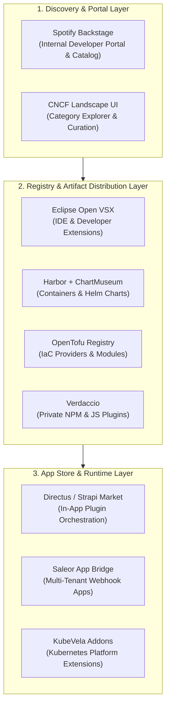

  

  
  
  
  
  
  
  

---

# 🛍️ Awesome Enterprise SaaS Marketplace Ecosystem

> **The Definitive Curated Directory of Cloud Hyperscaler Catalogs, B2B SaaS App Stores, Extension Registries, and Open-Source Marketplace Infrastructure.**

Welcome to the **Awesome Enterprise SaaS Marketplace** guide! Modern B2B software delivery relies heavily on partner ecosystems and app marketplaces to distribute, discover, and monetize extensions, plugins, and third-party SaaS integrations. This repository provides platform engineers, ISVs, enterprise architects, and ecosystem managers with verified pricing models, free tier boundaries, company scale benchmarks, and open-source infrastructure alternatives.

---

## 📑 Table of Contents

- [🌐 Sector Overview & Market Dynamics](#-sector-overview--market-dynamics)
- [🏢 Enterprise SaaS & Cloud Marketplaces (Hosted Platforms)](#-enterprise-saas--cloud-marketplaces-hosted-platforms)
  - [SaaS Marketplaces Comparison Matrix](#-saas-marketplaces-comparison-matrix)
  - [Detailed Platform Breakdown](#-detailed-platform-breakdown)
- [💻 Open-Source Extension Registries & Marketplace Infrastructure](#-open-source-extension-registries--marketplace-infrastructure)
  - [Ranked Open-Source Projects (By GitHub_Stars)](#-ranked-open-source-projects-by-github-stars)
  - [Self-Hosted Enterprise Marketplace Architecture](#-self-hosted-enterprise-marketplace-architecture)
- [🤝 How to Contribute](#-how-to-contribute)
- [⚖️ Disclaimer & Compliance](#-disclaimer--compliance)
- [📈 Star History](#-star-history)
- [💖 Support & Sponsorship](#-support--sponsorship)

---

## 🌐 Sector Overview & Market Dynamics

The global **Cloud & Enterprise SaaS Marketplace** sector is valued at approximately **$15.5 Billion in 2024–2025** and is projected to surpass **$85+ Billion by 2030**, compounding at a rapid **CAGR of ~38%**. Growth is fueled by enterprise buyers burning down committed cloud spend (e.g., AWS EDP, Microsoft MACC, and Google Cloud Commitments) through consolidated marketplace procurement and automated governance.

### 📊 Market Structure & Concentration
- **Hyperscaler Infrastructure Tier (Highly Concentrated / Winner-Take-Most):** The core cloud marketplace layer is heavily consolidated among the top three hyperscalers—**AWS Marketplace, Microsoft Azure Marketplace, and Google Cloud Marketplace**—which collectively facilitate over 70% of all transacted enterprise marketplace volume. These platforms leverage balance-sheet financing, consolidated enterprise billing, and 3% flat transaction take-rates to lock in enterprise ISVs.
- **Application & Domain-Specific Tier (Moderately Fragmented):** Outside the hyperscalers, the business application marketplace ecosystem is moderately fragmented across specialized platform champions (**Salesforce AppExchange** for CRM, **Shopify App Store** for global commerce, **Atlassian Marketplace** for developer collaboration, and **ServiceNow Store** for IT workflows). Each category leader commands a defensible moat built upon proprietary APIs, custom SDKs, developer certification programs, and high-switching-cost enterprise workflows.

---

## 🏢 Enterprise SaaS & Cloud Marketplaces (Hosted Platforms)

Below is the verified breakdown of the category-leading enterprise SaaS marketplaces. Entries are sorted in **descending order by company scale** (Market Capitalization / Corporate Valuation & Annual Revenue).

### 📊 SaaS Marketplaces Comparison Matrix

| Marketplace / Platform | Parent Company & Scale (Valuation / Revenue) 🔽 | Starting Tier Pricing (Listing / Platform) | Free Tier & Trial Limits | Ecosystem Focus & Scale |
| :--- | :--- | :--- | :--- | :--- |
| **[Microsoft Azure Marketplace](https://azuremarketplace.microsoft.com/)** | **~$3.10 Trillion Market Cap** *(FY24 Revenue: $245.1B)* | **$0 listing fee**; **3% flat transaction fee** for transactable SaaS/VM offers; Pay-As-You-Go starts at **$0 upfront** *(Partner Action Pack: $475/yr)* | **$200 credit for 30 days** upon signup + **12 months of popular services free** (750 hrs B1s VM, 5 GB Blob storage) + **55+ services free forever** (1M Azure Functions calls/mo) | 30,000+ certified apps; MACC commitment drawdowns, managed VMs, Kubernetes apps. |
| **[Google Cloud Marketplace](https://cloud.google.com/marketplace)** | **~$2.10 Trillion Market Cap** *(FY24 Revenue: $350.0B)* | **$0 listing fee**; **3% flat revenue share** on transacted offers; Partner Advantage membership starts at **$0 (Member)** / **$500/yr (Partner)** | **$300 free credits for 90 days** across all GCP services + **Google Cloud Free Tier forever** (1 e2-micro VM/mo in US, 5 GB storage, 2M Cloud Functions invocations/mo) | GKE Kubernetes apps, VM appliances, private SaaS contracts, unified GCP billing. |
| **[AWS Marketplace](https://aws.amazon.com/marketplace)** | **~$1.90 Trillion Market Cap** *(FY24 Revenue: $638.0B; AWS $105B)* | **$0 listing fee**; **1.5% to 3.0% transaction fee** on transacted SaaS contracts & private offers; APN starts at **$0 (Registered)** / **$2,500/yr (Validated)** | **750 hrs/mo EC2 (t2/t3.micro) + 5 GB S3 storage for 12 months**; **Always Free Tier** includes 1M Lambda calls/mo, 25 GB DynamoDB, 10 CloudWatch metrics | 15,000+ active listings, 3,500+ ISVs, AMI/container deployment, Vendor Insights security catalog. |
| **[Salesforce AppExchange](https://appexchange.salesforce.com/)** | **~$280 Billion Market Cap** *(FY25 Revenue: $38.0B)* | **$2,500 one-time security review fee** for paid apps ($0 for free apps); **15% revenue share** on paid ISVforce apps; Starter CRM starts at **$25/user/month** | **30-day full-featured free trial** across Starter/Enterprise (up to 25 users, no credit card required) + **Developer Edition free forever** (2 Salesforce licenses, 5 MB data storage, 20 MB file storage) | 7,000+ apps, 1,000+ consulting partners, 100k+ reviews; managed packages, native CRM objects. |
| **[ServiceNow Store](https://store.servicenow.com/)** | **~$190 Billion Market Cap** *(FY24 Revenue: $10.9B)* | **$5,000/year** Technology Partner Program (Associate Tier); **15% to 20% revenue share** on store sales; core ITSM starts at **~$100/user/month** *(enterprise contracts)* | **Personal Developer Instance (PDI) free forever** (full Now Platform API access; auto-hibernates after 10 days of inactivity, reclaimed after 14 days idle); **15-day enterprise trial** | Certified scoped workflow applications, IT Service Management, automated SecOps extensions. |
| **[Shopify App Store](https://apps.shopify.com/)** | **~$110 Billion Market Cap** *(FY24 Revenue: $8.9B)* | **$0 developer registration fee**; **0% revenue share** on first $1,000,000 USD annual app revenue (15% thereafter); Basic merchant plan starts at **$39/month** *(or $29/mo billed annually)* | **Shopify Partner Account free forever** (unlimited development test stores, test checkouts, API sandboxes); Merchant plans offer **3-day free trial** + $1/month promo for first month | 8,000+ merchant apps; Shopify Functions, App Bridge UI SDK, Checkout Extensibility APIs. |
| **[Workday App Gateway](https://www.workday.com/)** | **~$65 Billion Market Cap** *(FY25 Revenue: $8.4B)* | **~$10,000/year** Software Partner Program + **15% to 20% revenue share**; Core HCM/ERP enterprise subscriptions start at **~$100/employee/month** *(minimum commitments apply)* | **No permanent free tier**; **30-day sandbox environment access** provided to approved partners in the Workday Innovation Network for API verification & testing | Enterprise-vetted connectors, Workday Extend custom apps, payroll, HCM, financial integrations. |
| **[Atlassian Marketplace](https://marketplace.atlassian.com/)** | **~$45 Billion Market Cap** *(FY24 Revenue: $4.4B)* | **$0 listing fee**; **10% revenue share** for Cloud apps (25% for Data Center); Jira & Confluence Cloud starts at **$8.15/user/month** *(Standard Cloud tier)* | **Free forever plan for Jira & Confluence** for up to **10 users** (2 GB storage, community support, core scrum/kanban boards) + **Free Cloud Developer Sandbox** (5 test seats) | 5,000+ apps for Jira, Confluence, Bitbucket; serverless Forge runtime, Connect framework. |
| **[HubSpot App Marketplace](https://ecosystem.hubspot.com/marketplace/apps)** | **~$28 Billion Market Cap** *(FY24 Revenue: $2.6B)* | **$0 listing fee**; **0% revenue share** on public listings; App Partner Program is **$0 to join**; HubSpot Starter Customer Platform starts at **$15/seat/month** | **HubSpot Free Tools forever** (up to 5 users, 1,000 marketing contacts, free CRM, website forms, 2,000 marketing emails/mo) + **Free Developer Accounts** (unlimited test portals) | 1,500+ CRM integrations, marketing workflows, custom timeline events, UI extension cards. |
| **[Zendesk Marketplace](https://www.zendesk.com/marketplace/)** | **~$10.2 Billion Valuation** *(Hellman & Friedman; ~$1.7B ARR)* | **$0 listing fee**; **0% to 15% revenue share** based on billing model; Zendesk Support Team plan starts at **$19/agent/month** *(annual)* or **$25/agent/month** *(monthly)* | **14-day full-featured free trial** across all Support Suite plans (up to 5 agent seats, omnichannel routing) + **Zendesk Partner Sandbox free forever** for registered app developers | 1,500+ listings for Support, Chat, Messaging, and Sell; Zendesk Apps Framework (ZAF) v2. |

---

### 🔍 Detailed Platform Breakdown

- **[Microsoft Azure Marketplace](https://azuremarketplace.microsoft.com/)**  
  Enterprise marketplace hub integrated directly with the Azure Portal and Microsoft 365 Admin Center. Supports SaaS contracts, virtual machine images, Azure Kubernetes Service (AKS) apps, and consulting offers. Enables buyers to apply 100% of eligible transactable purchases toward their Microsoft Azure Consumption Commitment (MACC).
- **[Google Cloud Marketplace](https://cloud.google.com/marketplace)**  
  Curated digital catalog for deploying enterprise software directly into Google Cloud infrastructure. Features click-to-deploy Kubernetes applications, VM appliances, and SaaS subscriptions. Purchases roll directly into unified Google Cloud invoices with committed use discounts.
- **[AWS Marketplace](https://aws.amazon.com/marketplace)**  
  The industry's most established cloud catalog with 15,000+ transacted listings. Offers automated software provisioning via CloudFormation, Amazon ECS/EKS container listings, flexible payment scheduling, custom Private Offers, and AWS Marketplace Vendor Insights for automated compliance auditing.
- **[Salesforce AppExchange](https://appexchange.salesforce.com/)**  
  The pioneering enterprise app store with over 7,000 apps and components. Features rigorous automated and manual security reviews, managed package licensing (LMA), and deep integration into Lightning Web Components and Salesforce Flow automations.
- **[ServiceNow Store](https://store.servicenow.com/)**  
  Marketplace for enterprise IT, employee experience, and customer workflow extensions. Applications are published as scoped packages, ensuring zero impact on host platform upgrades, security boundaries, and enterprise governance policies.
- **[Shopify App Store](https://apps.shopify.com/)**  
  The standard for e-commerce ecosystem extensibility with 8,000+ applications. Features developer-friendly 0% rev-share up to $1M/yr, Shopify Functions for executing custom backend logic on Shopify's global edge infrastructure, and Checkout UI extensions.
- **[Workday App Gateway](https://www.workday.com/)**  
  Curated enterprise integration gateway for Fortune 500 HR and financial operations. Provides pre-built connectors and custom applications built on Workday Extend, adhering to strict enterprise multi-tenant security requirements.
- **[Atlassian Marketplace](https://marketplace.atlassian.com/)**  
  Ecosystem hub for developer and project management tooling across Jira, Confluence, and Jira Service Management. Built on Atlassian Forge, a serverless, hosted execution platform that eliminates cloud hosting overhead for third-party developers.
- **[HubSpot App Marketplace](https://ecosystem.hubspot.com/marketplace/apps)**  
  High-velocity CRM app marketplace featuring 1,500+ verified partner applications. Provides bi-directional contact syncing, custom workflow actions, timeline events, and custom CRM card iframe extensions.
- **[Zendesk Marketplace](https://www.zendesk.com/marketplace/)**  
  Customer support and omnichannel ticketing marketplace. Powered by the Zendesk Apps Framework (ZAF) v2, allowing developers to embed single-page applications into ticketing, user profiles, and navigation sidebars.

---

## 💻 Open-Source Extension Registries & Marketplace Infrastructure

Looking to build a self-hosted extension registry, internal developer portal, or custom app store without vendor lock-in? Below is a comprehensive, actively maintained directory of open-source projects, registries, and catalog frameworks.

All projects are sorted in **descending order by GitHub Stars_Count** 🔽.

### 🌟 Ranked Open-Source Projects (By GitHub_Stars)

| # | Project Name & Repository | GitHub_Stars_Badge | License | Description & Marketplace Utility |
| :-: | :--- | :--- | :--- | :--- |
| **1** | **[Strapi](https://github.com/strapi/strapi)** |  | `MIT` | Leading open-source headless CMS with an integrated **Strapi Market** that provides in-app discovery, installation, and dependency management for community and enterprise plugins. |
| **2** | **[Homebrew](https://github.com/Homebrew/brew)** |  | `BSD-2-Clause` | The iconic package manager for macOS and Linux. Powers decentralized tap repositories, formula catalogs, and cask registries for open tool marketplaces. |
| **3** | **[Mattermost](https://github.com/mattermost/mattermost)** |  | `AGPL-3.0` | Open-source enterprise collaboration platform featuring an official **Mattermost App Marketplace** for distributing plugins, webhooks, and third-party bots. |
| **4** | **[Portainer](https://github.com/portainer/portainer)** |  | `zlib` | Container and Kubernetes management platform featuring an extensible **App Templates Marketplace** for one-click deployment of containerized services and add-ons. |
| **5** | **[Directus](https://github.com/directus/directus)** |  | `GPL-3.0` | Open-source data engine with an in-app **Directus Marketplace** allowing seamless installation, sandboxing, and version management for custom extensions, displays, and endpoints. |
| **6** | **[Backstage](https://github.com/backstage/backstage)** |  | `Apache-2.0` | CNCF Incubation developer portal framework created at Spotify. Acts as an internal enterprise service and plugin marketplace with a unified Software Catalog and TechDocs. |
| **7** | **[Harbor](https://github.com/goharbor/harbor)** |  | `Apache-2.0` | CNCF-graduated enterprise artifact registry that stores, signs, and scans container images and Helm charts with multi-tenant RBAC and automated vulnerability audits. |
| **8** | **[Saleor](https://github.com/saleor/saleor)** |  | `BSD-3-Clause` | Modern headless composable commerce API featuring the **Saleor App Store** framework with webhook-driven extension sandboxing and App Bridge iframe integration. |
| **9** | **[Verdaccio](https://github.com/verdaccio/verdaccio)** |  | `MIT` | Lightweight zero-config private npm proxy registry. Ideal for internal enterprise JavaScript extension distribution, plugin registries, and offline package caching. |
| **10** | **[npm CLI](https://github.com/npm/cli)** |  | `Artistic-2.0` | The foundational package manager client and protocol for JavaScript package registries, version resolution, and artifact publishing. |
| **11** | **[CNCF Landscape](https://github.com/cncf/landscape)** |  | `Apache-2.0` | Interactive catalog and discovery map for complex cloud native ecosystems, serving as an architectural blueprint for building interactive category directories. |
| **12** | **[KubeVela](https://github.com/kubevela/kubevela)** |  | `Apache-2.0` | Application delivery engine based on Open Application Model (OAM), featuring a modular **Addon Registry** system to distribute, version, and manage platform extensions. |
| **13** | **[Warehouse (PyPI)](https://github.com/pypi/warehouse)** |  | `Apache-2.0` | The production codebase powering the Python Package Index (PyPI). Reference architecture for high-concurrency package metadata indexing, secure publishing, and API endpoints. |
| **14** | **[ChartMuseum](https://github.com/helm/chartmuseum)** |  | `Apache-2.0` | Open-source Helm Chart Repository server in Go. Integrates with AWS S3, Google Cloud Storage, Azure Blob, and MinIO for cloud native application distribution. |
| **15** | **[Sharetribe Go](https://github.com/sharetribe/sharetribe)** |  | `Community` | Battle-tested open-source marketplace software for multi-vendor listings, transaction workflows, booking calendars, and payment processing. |
| **16** | **[Open VSX](https://github.com/eclipse-openvsx/openvsx)** |  | `EPL-2.0` | Vendor-neutral, open-source alternative to Microsoft Visual Studio Marketplace. Serves 600M+ extension downloads monthly across VS Code forks, Gitpod, and SAP Code Editor. |
| **17** | **[F-Droid Server](https://github.com/f-droid/fdroidserver)** |  | `AGPL-3.0` | Decentralized application store repository server and build infrastructure for hosting cryptographically signed app catalogs and updates. |
| **18** | **[OpenTofu Registry](https://github.com/opentofu/registry)** |  | `MPL-2.0` | Open-source infrastructure-as-code registry for Terraform/OpenTofu providers and modules. Provides search endpoints, documentation generation, and version tracking. |
| **19** | **[Nextcloud App Store](https://github.com/nextcloud/appstore)** |  | `AGPL-3.0` | The official open-source app store platform powering Nextcloud's ecosystem. Supports app developer verification, signature validation, and automated updates. |
| **20** | **[CARE AppStore Registry](https://github.com/ohcnetwork/care_apps_registry)** |  | `MIT` | Static JSON-based app registry for digital healthcare platforms. Generates validated indexes for featured apps, categories, and automated extension downloads. |

---

### 🏗️ Self-Hosted Enterprise Marketplace Architecture

By composing specialized open-source registries, platform teams can construct an independent, enterprise-grade private SaaS marketplace:

---

## 🤝 How to Contribute

Contributions are welcome and appreciated! Help keep this repository accurate and up-to-date:

1. 🍴 **Fork the repository** on GitHub.
2. 🌿 **Create a feature branch**: `git checkout -b feature/add-new-marketplace`
3. 📝 **Add or update an entry** in `README.md` following the existing format:
   - Include platform name, official link, company valuation/scale, specific starting price, and exact free tier/trial limits.
   - For open-source projects, include the repository link, description, and Stars_Badge (`style=social&color=white`).
4. 🧪 **Verify all links and data points** before submitting.
5. 🚀 **Submit a Pull Request** with a concise description of your additions.

---

## ⚖️ Disclaimer & Compliance

- This repository is a community-maintained resource curated for educational and architectural evaluation.
- Commercial trademarks, brand names, and logos are property of their respective owners (Microsoft, Amazon, Google, Salesforce, ServiceNow, Shopify, Workday, Atlassian, HubSpot, Zendesk).
- Organizations handling payment processing, billing tokens, and third-party partner code should ensure compliance with global data protection frameworks (**GDPR, CCPA/CPRA, SOC 2 Type II, ISO 27001**) and payment standards (**PCI-DSS**).
- Open-source registries exposed to public submissions require strict software supply chain defenses, dependency pinning, and cryptographic code signing.

---

## 📈 Star History

---

## 💖 Support & Sponsorship

Thank you for exploring and utilizing this curated repository! If this guide helps you navigate or build enterprise SaaS marketplaces:

- ⭐ **Star this repository** to support discoverability and bookmark updates.
- 🍴 **Fork the repo** to tailor it for your internal platform and partner team needs.
- 📢 **Share it** with your network across Twitter/X, LinkedIn, Reddit, and Discord.
- ☕ **Sponsor the Project**: Support ongoing maintenance and curated ecosystem research via the [GitHub Sponsors Dashboard](https://github.com/sponsors/ishandutta2007).

---

  <b>Curated with ❤️ by <a href="https://github.com/ishandutta2007">Ishan Dutta</a> and the Global Open-Source Community.</b> 
  Part of the <a href="https://github.com/ishandutta2007/Awesome-Awesome-Awesome">Awesome-Awesome-Awesome</a> collection.

